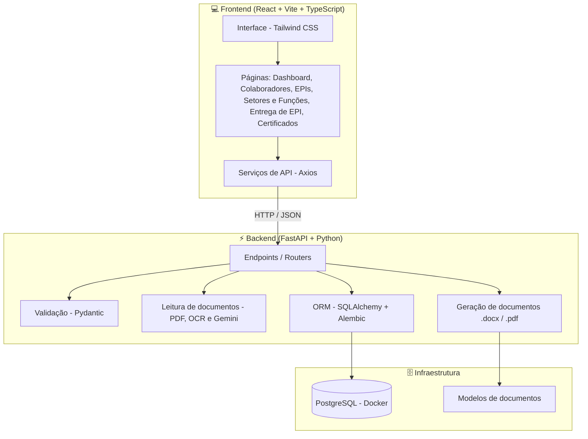
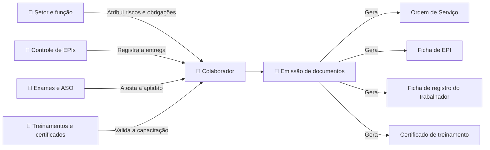

# 🦺 SicherPlan

Sistema de gestão de Saúde e Segurança do Trabalho (SST) que centraliza colaboradores, EPIs, exames (ASO), treinamentos, documentos e vencimentos, e usa IA para ler documentos e preencher cadastros.


## Por que existe

Na rotina de um técnico de segurança, o controle de EPIs, ASOs, treinamentos e vencimentos vive em planilhas soltas e no papel. Um exame vence sem ninguém perceber, um EPI com CA vencido é entregue, um certificado é emitido para quem não poderia recebê-lo. O SicherPlan nasceu dessa rotina: foi pensado por quem trabalha com SST no dia a dia.

## ⭐ Destaques

- **Regra que protege vidas:** a aptidão para trabalho em altura é obrigatória no cadastro, e o ASO mais recente a atualiza. **Quem está inapto não recebe o certificado de NR-35.**
- **IA lendo documentos:** RG, CNH, ASO e o certificado de aprovação (CA) do EPI são lidos (texto do PDF, OCR e, quando falta algum campo, o Gemini) e preenchem o cadastro para conferência.
- **Pendências por função:** cada função define os EPIs e treinamentos obrigatórios; ao mudar a função do colaborador, as exigências são recalculadas.
- **Certificados gerados automaticamente** (NR-06, NR-18 e NR-35), com reciclagem e reemissão 30 dias antes do vencimento.
- **LGPD:** o ASO é dado de saúde (dado sensível). Quando a IA é usada, o sistema orienta usar uma chave de projeto com faturamento ativo, que não usa o conteúdo para treinar o modelo.

## ✅ O que já funciona

| Módulo | Status |
|---|---|
| Setores e funções (com descrição da função conforme o PGR) | ✅ |
| Colaboradores, com leitura de RG e CNH por OCR e IA | ✅ |
| EPIs e CAs, com importação do PDF do CA | ✅ |
| Matriz de EPIs obrigatórios por função | ✅ |
| Entrega de EPIs, com bloqueio de EPI vencido | ✅ |
| ASOs: histórico, edição e leitura do PDF | ✅ |
| Treinamentos obrigatórios por função | ✅ |
| Certificados NR-06, NR-18 e NR-35 (com bloqueio da NR-35 para inaptos) | ✅ |
| Dashboard de vencimentos | ✅ |
| Upload e acompanhamento de documentos | 🟡 parcial |

## 🛣️ Próximos passos

- [ ] Upload de documentos por colaborador, com status (anexado, pendente, vencido)
- [ ] Login com JWT
- [ ] Testes automatizados com Pytest nas regras principais (entrega de EPI vencido, pendências)
- [ ] Certificado NR-12
- [ ] Ficha de EPI e Ordem de Serviço em documento
- [ ] **Agente de IA** (somente leitura): responder dúvidas sobre as NRs, consultar o sistema e gerar relatório de pendências. Qualquer alteração feita pela IA exigirá confirmação explícita do usuário.

## 🏗️ Arquitetura





## 📏 Regras de negócio principais

- Todo colaborador deverá possuir um setor e uma função;
- setores e funções em uso não poderão ser excluídos;
- EPIs vencidos não poderão ser entregues;
- as pendências deverão ser recalculadas após alteração de função;
- vencimentos deverão aparecer no dashboard;
- documentos deverão ser vinculados ao colaborador correto;
- arquivos enviados deverão ter validação de formato e tamanho;
- o acesso aos dados deverá exigir autenticação.

## 🔍 Funcionalidades em detalhe

### Colaboradores

- Cadastro de colaboradores;
- associação com setor e função;
- controle de colaboradores ativos e inativos;
- visualização dos dados cadastrais;
- histórico de mudanças de função;
- identificação de EPIs e documentos pendentes;
- aptidão para trabalho em altura (apto ou inapto) obrigatória no cadastro; quem está inapto não pode receber o certificado de NR-35.

#### ASOs na gestão do colaborador

Em **Detalhes do colaborador › Saúde ocupacional › Editar** (só para colaboradores já cadastrados):

- histórico de ASOs do colaborador, com edição e exclusão;
- cadastro de ASO com tipo (admissional, periódico, retorno ao trabalho, mudança de risco ocupacional ou demissional), data do exame clínico, data de liberação, vencimento, resultado (apto ou inapto), aptidão para trabalho em altura e exames realizados com as datas;
- importação do PDF (ou foto) do ASO: os campos são lidos e preenchidos para conferência antes de salvar. A leitura é feita primeiro no servidor (texto do PDF ou OCR) e a IA (Gemini) só entra quando falta algum campo;
- aviso quando o CPF ou o nome do ASO não batem com o cadastro;
- vencimento sugerido de 12 meses após a liberação, ajustável conforme o PCMSO; o demissional não vence;
- o ASO mais recente atualiza a aptidão para trabalho em altura do cadastro (ex.: apto no admissional e inapto no periódico bloqueia a NR-35).

> O ASO contém dado de saúde (dado sensível na LGPD). Quando a IA é usada, o arquivo é enviado ao Google: use uma chave do Gemini de projeto com faturamento ativo.

### EPIs

- Cadastro de equipamentos de proteção individual;
- classificação por grupo de proteção;
- controle do Certificado de Aprovação (CA);
- validade e status do CA;
- upload do documento do CA;
- controle de durabilidade do EPI;
- ordenação por vencimento;
- bloqueio de entrega de equipamentos vencidos.

### Setores e funções

- Cadastro de setores e funções, com nome, setor e descrição da função (as atividades do cargo, conforme o PGR);
- descrição da função atual exibida nos detalhes do colaborador;
- definição de EPIs obrigatórios por função;
- cadastro de treinamentos e documentos exigidos;
- atualização das exigências quando a função do colaborador for alterada.

### Entrega de EPIs

- Seleção do colaborador;
- pesquisa de EPI por nome ou CA;
- registro de data, quantidade e observações da entrega;
- histórico de equipamentos fornecidos;
- geração da ficha de EPI.

### Documentos e vencimentos

- Upload de documentos obrigatórios;
- controle dos status anexado, pendente, válido e vencido;
- cadastro e acompanhamento de ASOs;
- controle de certificados e treinamentos;
- alertas para documentos próximos do vencimento;
- manutenção do histórico de documentos vencidos.

### Dashboard

- Exames e ASOs próximos do vencimento;
- documentos e certificados vencidos ou a vencer;
- EPIs com CA próximo do vencimento;
- EPIs obrigatórios pendentes por colaborador;
- filtros por setor;
- visão geral de colaboradores ativos e inativos.

### Geração de documentos

O sistema deverá gerar documentos padronizados utilizando os dados já cadastrados, incluindo:

- Certificado NR 06;
- Certificado NR 12;
- Certificado NR 18;
- Certificado NR 35;
- Ficha de EPI;
- Ordem de Serviço.

### Agente de IA

O agente de IA será desenvolvido em uma etapa posterior e poderá:

- responder dúvidas relacionadas à SST;
- fornecer explicações baseadas nas Normas Regulamentadoras;
- consultar informações do sistema em modo de leitura;
- gerar relatórios de pendências;
- sugerir ações para regularização.

Alterações ou criação de registros por meio da IA deverão exigir confirmação explícita do usuário.

## 📁 Estrutura do projeto

```text
sicherPlan/
├── frontend/       # Interface e navegação do sistema
├── backend/        # API, regras de negócio e acesso ao banco
├── docs/           # Planejamento, requisitos e documentação
└── README.md
```

## Como inicializar o ambiente local

### Requisitos

- Docker com Docker Compose;
- Python 3 e `venv`;
- Node.js 22.12 ou superior e npm.

Execute os comandos de Docker na raiz do repositório. Mantenha o banco, o backend e o frontend em terminais separados para que cada processo continue em execução.

### 1. Configure o `.env`

O backend procura o arquivo `.env` na pasta atual ou nas pastas acima. Crie-o na raiz do projeto, ao lado de `docker-compose.yml`. Se ainda não existir, copie o exemplo:

```bash
cp .env.example .env
```

No PowerShell:

```powershell
Copy-Item .env.example .env
```

### 2. Inicie o PostgreSQL

Na raiz do projeto:

```bash
docker compose up -d postgres
```

Confirme que o container está saudável:

```bash
docker compose ps
docker compose exec postgres sh -c 'pg_isready -U "$POSTGRES_USER" -d "$POSTGRES_DB"'
```

O Compose lê o `.env` da raiz para configurar o banco. As variáveis `POSTGRES_*` são aplicadas quando o volume é inicializado pela primeira vez; mudar a senha no `.env` depois disso não altera a senha gravada no volume existente.

### 3. Prepare e inicie o backend

Em um segundo terminal, a partir da raiz do projeto:

```bash
cd backend
python3 -m venv venv
source venv/bin/activate
python -m pip install -r requirements.txt
python -m uvicorn main:app --reload
```

No PowerShell, use os comandos equivalentes:

```powershell
cd backend
python -m venv venv
.\venv\Scripts\Activate.ps1
python -m pip install -r requirements.txt
Remove-Item Env:DATABASE_URL -ErrorAction SilentlyContinue
$env:POSTGRES_PORT = "5433"
python -m uvicorn main:app --reload
```

Ative sempre o virtualenv antes de instalar dependências ou iniciar Uvicorn. Inicie o comando com a pasta atual em `backend`, para que `main:app` seja encontrado. A aplicação cria as tabelas que faltam e aplica as migrações de `backend/migrations` no startup. O banco começa vazio; os dados de teste usados no início do projeto ficam guardados como histórico em `docs/historico/seed_data_teste.py`.

Confirme a API em `http://127.0.0.1:8000/` (deve retornar `{"status":"Backend do SicherPlan rodando"}`) e acesse a documentação em `http://127.0.0.1:8000/docs`.

### 4. Inicie o frontend

Em um terceiro terminal, a partir da raiz:

```bash
cd frontend
npm install
npm run dev
```

Abra a URL exibida pelo Vite, normalmente `http://localhost:5173`. O frontend está configurado para chamar a API em `http://127.0.0.1:8000`; portanto, mantenha o backend em execução. Não é necessário criar um `.env` para o frontend neste momento.

Para validar o build de produção ou visualizá-lo localmente:

```bash
npm run build
npm run preview
```

### Encerrar e resolver problemas comuns

- Para parar cada processo, use `Ctrl+C` no terminal correspondente. `docker compose down` para e remove o container e a rede, mas preserva o volume do banco.
- `password authentication failed`: confira se `POSTGRES_PASSWORD` e a senha da `DATABASE_URL` correspondem à senha usada quando o volume foi criado. Alterar o `.env` não atualiza um volume existente.
- Erro indicando conexão em `localhost:5432`: confira `POSTGRES_PORT`, a porta da `DATABASE_URL` e variáveis antigas exportadas no terminal. Para este Compose, o acesso do backend deve ser pela porta `5433`.
- `Address already in use` na porta `8000`: verifique `http://127.0.0.1:8000/` antes de iniciar outro Uvicorn. Se a API já estiver respondendo, continue usando essa instância; caso contrário, encerre o processo anterior com `Ctrl+C` no terminal em que ele foi iniciado. O frontend está configurado para usar a porta `8000`.
- Só reinicialize o banco se puder apagar todos os dados locais. Para remover o banco e recriá-lo do zero, execute na raiz:

```bash
docker compose down
docker volume rm sicherplan_postgres_data
docker compose up -d postgres
```

O comando `docker volume rm` é destrutivo: apaga permanentemente os dados desse banco local. Não use `docker compose down -v` como tentativa de corrigir autenticação sem confirmar que deseja apagar o volume.

## Status do projeto

MVP em cerca de 75%, em desenvolvimento ativo. Desenvolvido por [Lucila Vitória](https://github.com/byluxp), com o Claude Code como par de programação.
